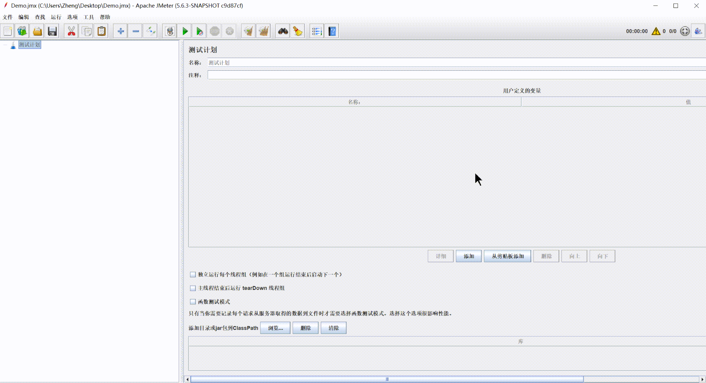

# Gitee Ai - JMeter Agent

[English](README_en.md) | 中文

Gitee Ai 是一个 JMeter AI 助手插件：用自然语言描述需求，AI 直接在你的测试计划树上创建、修改、运行和排查测试计划。



## 核心特性

- **一句话生成测试计划** — 描述需求（如「10 个线程对某接口发 GET 请求并校验响应码」），AI 直接在测试树上创建线程组、采样器、断言、定时器，无需手填表单
- **直接操作测试计划树** — 元素增删改、移动、复制、批量启停，改动即时可见；也可以让 AI 分析现有计划、排查问题
- **参数自动校验** — 73 个 JMeter 组件的参数 Schema，属性名、类型、取值范围写错立即报错，不用等到运行时
- **测试运行也交给 AI** — 启动/停止测试、读取实时状态与结果（响应时间、吞吐量、错误率），断言失败信息自动暴露给 AI 排查
- **8 家模型可选，DeepSeek 开箱即用** — Anthropic Claude、OpenAI、DeepSeek、智谱 GLM、Moonshot Kimi、MiniMax、LangCat，以及本地 Ollama
- **选中联动** — 聊天面板实时显示你在 JMeter 里选中的元素，一键注入到 AI 上下文
- **跨会话记忆** — 记住你的偏好与历史操作，关闭 JMeter 时自动归档
- **安全护栏** — 文件访问白名单、SSRF 防护、危险命令拦截

## 快速开始

适用于 **JMeter 5.6.3 + JDK 17 或更高版本**。

### 1. 下载

到 [Releases](https://github.com/azhengzz/JMeter-Agent/releases) 页下载最新版本的两个附件：

- `jmeter-agent-x.y.z.jar` — 插件本体
- `jmeter-agent.zip` — 技能与模板文件

### 2. 安装

- 把 jar 放入 `<jmeter安装目录>/lib/ext/`
- 把 zip 解压后的**全部内容**复制到 `<jmeter安装目录>/bin/jmeter-agent/`

### 3. 配置

推荐先把 [jmeter-ai-sample.properties](jmeter-ai-sample.properties) 的**全部内容追加**到 `<jmeter安装目录>/bin/user.properties`（或 `jmeter.properties`）——所有可调参数都在手边，后续按需修改即可。

然后配置密钥。默认提供者为 DeepSeek，只配它即可直接使用：

```properties
deepseek.api.key=your-api-key
```

换其他提供者时需同时指定，例如 Anthropic Claude：

```properties
anthropic.api.key=your-api-key
jmeter.ai.default.provider=anthropic
```

| 提供者 | 获取 API Key |
|--------|-------------|
| DeepSeek | [platform.deepseek.com](https://platform.deepseek.com) |
| 智谱 GLM | [open.bigmodel.cn](https://open.bigmodel.cn) |
| Moonshot Kimi | [platform.moonshot.cn](https://platform.moonshot.cn) |
| MiniMax | [api.minimax.com](https://api.minimax.com) |
| LangCat | [longcat.chat](https://longcat.chat) |
| Anthropic | [console.anthropic.com](https://console.anthropic.com) |
| OpenAI | [platform.openai.com](https://platform.openai.com) |

### 4. 重启 JMeter

配置只在启动时读取——改了 `user.properties` 必须重启 JMeter 才生效。

### 5. 开始对话

点击菜单栏 **AI** 菜单或工具栏 AI 按钮（快捷键 `Alt+V`）打开聊天面板，直接描述你的需求：

> 创建一个包含 10 个线程的线程组，发送 GET 请求到 http://example.com，并添加响应码为 200 的断言

常用命令：`/new` 开新会话 · `/status` 查状态 · `/goal <需求>` 让 AI 自主迭代直到目标达成 · `/help` 查看全部命令。

> 想从源码构建？设置 `JMETER_HOME` 环境变量后执行 `mvn clean install`。

## 卡住了？

- **改了配置没生效** — `user.properties` 只在启动时读取，重启 JMeter。
- **怎么换模型** — 配置对应提供者的 key 并设置 `jmeter.ai.default.provider`（见上方第 3 步示例）；运行中也可在面板下方的模型选择器直接切换。
- **不想花 API 费用** — 用 [Ollama](https://ollama.com) 跑本地模型，无需 API Key：设 `jmeter.ai.default.provider=ollama` 即可（默认端点 `http://localhost:11434/v1`）。
- **Alt+V 没反应 / 找不到 AI 菜单** — 检查 jar 是否在 `lib/ext/`、zip 内容是否解压到了 `bin/jmeter-agent/`、JMeter 是否已重启。

## 进阶

| 想做什么 | 去哪 |
|---------|------|
| 调整温度、上下文窗口等参数 · 全部配置项与各模型推荐值 | [配置参考](documents/configuration.md)（中文） |
| 了解 Agent 有哪些工具、能做什么 | [Agent 工具清单](documents/agent-tools.md)（中文） |
| 用命令行 jmeter-cli 驱动 JMeter · 接入 Claude Code/Codex 等外部 Agent | [jmeter-cli 指南](documents/jmeter-cli.md)（中文） |
| 了解 Agent Loop 内部架构 | [docs/AGENT-LOOP.md](docs/AGENT-LOOP.md)（英文） |
| 为 Agent 扩充新 JMeter 组件（零 Java 改动） | [SCHEMA-GUIDE.md](documents/SCHEMA-GUIDE.md) |

## 免责声明

- **AI 局限性：** AI 可能产生错误信息，请在生产环境中验证所有建议
- **备份测试计划：** 在实施 AI 建议的大规模修改前，务必备份测试计划
- **API 费用：** 使用 API 会产生 Token 费用，请关注用量
- **安全：** 不要在对话中分享敏感信息（凭证、专有代码等）
- **性能影响：** 部分 AI 建议的配置可能影响测试性能，请监控资源使用

## 致谢

本项目在设计与实现中参考了以下开源项目：

- [nanobot](https://github.com/HKUDS/nanobot) — Agent 设计与实现参考
- [jmeter-ai](https://github.com/QAInsights/jmeter-ai) — 设计灵感参考

## 许可证

MIT License

<br>
<p align="center">
  Thanks for visiting ✨ <b>JMeter Ai Agent Plugin</b>
</p>
<p align="center">
  
</p>
